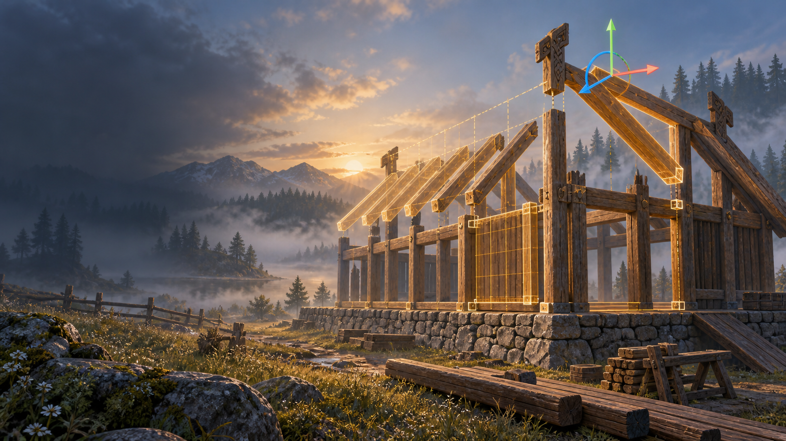

# BuildWorks

**English · [Русский](README_RU.md)**

BuildWorks extends Valheim's hammer with precise construction, a blueprint catalog and a dedicated editor. Import a supported building, edit its real pieces, place it through Valheim's normal construction path, and keep its supported transforms after reload. Capture and edit your own buildings too.



**Current source / isolated QA: 0.19.221.** Latest public binary: [0.19.37 alpha](https://github.com/MaikiOS/BuildWorks/releases/tag/v0.19.37-alpha), a historical prerelease. Its ZIP does not contain the newer source features. No new public binary release has been published.

**QA .221 installed: numerical long-wall recovery verified in Valheim.**30/30;54,336 inner RGBA texels match payload, three fresh recovery samples have smoke/surface/ledgerFlags0. Approved visual v11/house/FPS/board remain open. [Evidence and limits](docs/CHECKPOINT_221.md).

## Capabilities

- Hammer categories, search, recents, favorites and blueprint cards.
- Blueprint editor with object tree, groups, independent anchors, user snap points, Undo/Redo and interior camera.
- XYZ translation/rotation and component scaling1–1000%, numeric entry, single/paired axes, Array and Contour tools.
- Supported `.blueprint` / `.vbuild` imports, reviewed exports, categories, Save As, delete/hide, automatic portable files, Share and batch operations.
- Missing-part records retain transforms; explicit alignment copies leave originals intact. Unknown models are not invented.
- Native piece construction with survival resources and checks. A28-part Forest Hut and exact reload were verified; this does not prove every imported building or multiplayer.
- English fallback and Russian runtime catalog.

Further development brings editable assemblies and repetitions, construction guides, and original adaptive pieces. See the [plugin roadmap](docs/ROADMAP.md) for the full progression.

## In progress

Approved **v11 → whole unfinished house → persistent stake/board → material continuation/cancel/refund/reload** remains the priority. [.212](docs/FOG_RECOVERY_212.md) fixes a reproduced cross-frame error that removed the house after passage. The native house passed both directions without disappearing; the owner rejected dissolution/recovery and passage performance. Full-house appearance/speed and the persistent board remain open.

Storage/mount/admin restoration, direct player sharing, full server acceptance, volume-selection UX and heavy-building performance remain incomplete. Production interactive/editor budget is512 parts; isolated QA can exercise higher limits. No promise that arbitrary huge/modded builds work.

[Current evidence and limits](docs/CURRENT_STATUS.md) · [Forward roadmap](docs/ROADMAP.md) · [Development journal](docs/DEVELOPMENT_JOURNAL.md)

## Documentation

[Documentation index](docs/README.md) · [Features](docs/FEATURES.md) · [Controls](docs/CONTROLS.md) · [Installation](docs/INSTALL.md) · [Formats](specs/roadmap/blueprint-format.md) · [Architecture](docs/ARCHITECTURE.md) · [Localization](docs/LOCALIZATION.md)

Historical test reports keep their original version and scope. Build success, deployment, native game checks, owner acceptance and host+remote are separate evidence levels.

## Dependencies and source build

Valheim and BepInExPack Valheim5.4.x are required. Jotunn, TerrainRamp and EarthWorks are not runtime dependencies. Current host compatibility is recorded in [status](docs/CURRENT_STATUS.md).

Use .NET SDK and local host assemblies; never commit game DLLs:

```powershell
dotnet build .\src\BuildWorks\BuildWorks.csproj -c Release `
  -p:ProfileRoot="C:\path\to\BepInEx-profile" `
  -p:ValheimManagedDir="C:\path\to\Valheim\valheim_Data\Managed"
dotnet run --project .\tests\BuildWorks.GeometryTests\BuildWorks.GeometryTests.csproj -c Release
```

Default automated QA uses local ValheimQA, `../ValheimQA/RUNBOOK_RU.md`: direct GABS launch with TerrainRamp-1.0-Test BepInEx, existing isolated QA identities, state checks, normal exit and bridge restore. Standing18Oct2026 permission replaces Modded-only for these tests; never interrupt the owner session. Resets/new grants/unrelated world edits/other profiles/network need their own scope. The local stand is not distributed in GitHub.

## License

BuildWorks is proprietary/source-available, not open-source. Official binaries may be used for personal non-commercial testing. Source access/forking is permitted solely to prepare a pull request; reuse, redistribution or commercial use requires the owner's prior written permission. [LICENSE](LICENSE) governs; [Russian translation](LICENSE_RU.md) is for convenience. See [CONTRIBUTING](CONTRIBUTING.md).

The cover is concept art, not a gameplay screenshot. [Image provenance](docs/IMAGES.md). OBJ/FBX/glTF and terrain transfer are outside this module; EarthWorks integration is later work.
