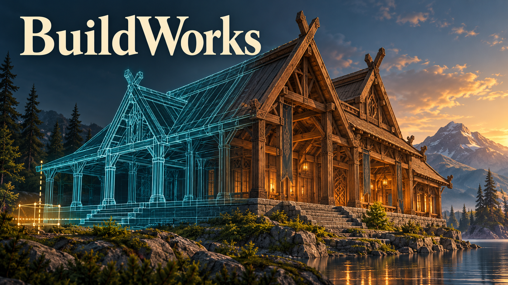
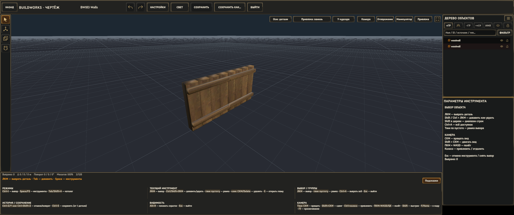
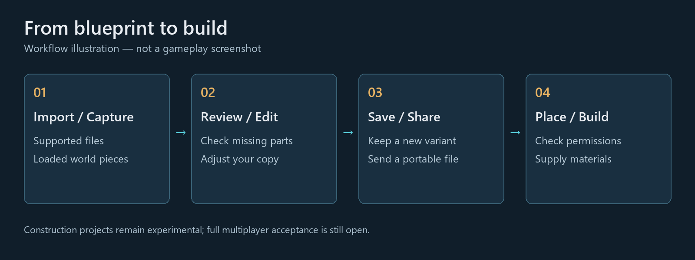

# BuildWorks

**English · [Русский](README_RU.md)**

Precision-building tools and reusable blueprints for Valheim: capture a build, refine its individual parts, and keep your own variations.

*Original promotional concept art. It is not a Valheim screenshot or a demonstration of a finished building workflow.*

## What you can do

- Position and rotate parts with XYZ controls, snapping, numeric values, and positive component scale.
- Edit blueprints with an object tree, groups, anchors, visibility controls, a dedicated camera, and Undo/Redo.
- Capture loaded building parts or import supported `.blueprint` and `.vbuild` files; review missing parts instead of silently replacing them.
- Organise variants with categories and Save As, then share saved portable files.
- Create repetitions with Array and Contour. Persistently editable repetition operations are future work.

The current private manual-test alpha is **0.19.328**. Alt-drag copy and an optional assumed-ground structural estimate are included; full-module and multiplayer acceptance remain open. The 0.19.329 candidate is not the issued alpha. [Version and limits](docs/ALPHA_0.19.328.md).

## See the tools

*Real .280 editor, Russian UI. Controlled rendering of the running editor camera and actual Canvas, not an OS screenshot. This shows the interface; it does not prove payment, reload, or multiplayer.*

*Illustration of the workflow, not a gameplay capture. Construction remains subject to resources, permissions, supported parts, and the limitations below.*

## Start with a small blueprint

1. Import a supported file or select your own loaded building parts.
2. Review the composition, edit a separate copy, and use Save As to keep a variant.
3. Inspect the placement preview and costs before confirming construction.

The [English wiki](https://github.com/MaikiOS/BuildWorks/wiki/Home) explains the controls, missing parts, categories, sharing, and experimental projects. The [Russian wiki](https://github.com/MaikiOS/BuildWorks/wiki/Home-RU) covers the same topics.

## Install and update safely

Use an explicitly published package compatible with your Valheim and BepInExPack Valheim 5.4.x versions. Close the game/server and back up your world, character, and BuildWorks data before updating.

Install the matching `BuildWorks.dll` and `BuildWorks.Geometry.dll` pair in `BepInEx/plugins/Ostrix-BuildWorks/`; remove duplicate installations. Check the loaded version in `BepInEx/LogOutput.log`. Do not mix DLL builds or assume a downgrade can read newer saved data. See [Installation](docs/INSTALL.md).

## Current limits

**Known issue in alpha 0.19.328:** 27 producer prefab names differ in letter case from the native registry. This is not fixed in the issued package; review missing parts on import. The correction and successful 251/502-part catalogue checks belong only to the internal 0.19.329 candidate. Eight bounded native data checks are accepted for that candidate. Four direct producer-profile checks (.blueprint/.vbuild) have passed independent review. Acceptance of 2.17 covers codec/profile data only in the internal 0.19.329 candidate. Gameplay sections 3–13 and multiplayer remain open.

Construction projects, staged materials, cancellation, and refunds are experimental, with limited local evidence. Full survival, item-property preservation, fault recovery, and host+remote acceptance remain open. File sharing is available; direct in-game player transfer is not connected. Capture uses loaded objects, not forced distant-zone streaming.

Large/modded buildings, contents restoration, volume-selection interaction, and ordinary mouse/visual edge cases need further validation. OBJ/FBX/glTF and terrain transfer are outside this blueprint module. EarthWorks is a separate future integration, not a dependency.

## Guides and development

[Controls](docs/CONTROLS.md) · [Documentation](docs/README.md) · [Roadmap](docs/ROADMAP.md) · [Contributing](CONTRIBUTING.md)

Future directions include editable assemblies/repetition, construction guides, and original adaptive pieces. They are not promises for the first release. [README maintenance standard](docs/README_STANDARD.md).

## Help and licence

For an issue, include versions, the relevant log, steps, and a permitted example file. Keep private saves and tokens out of public reports. [Report an issue](https://github.com/MaikiOS/BuildWorks/issues).

BuildWorks is proprietary/source-available, not open-source. Personal non-commercial testing of official binaries and contribution access follow the [licence](LICENSE); redistribution and other reuse require the owner's written permission.
