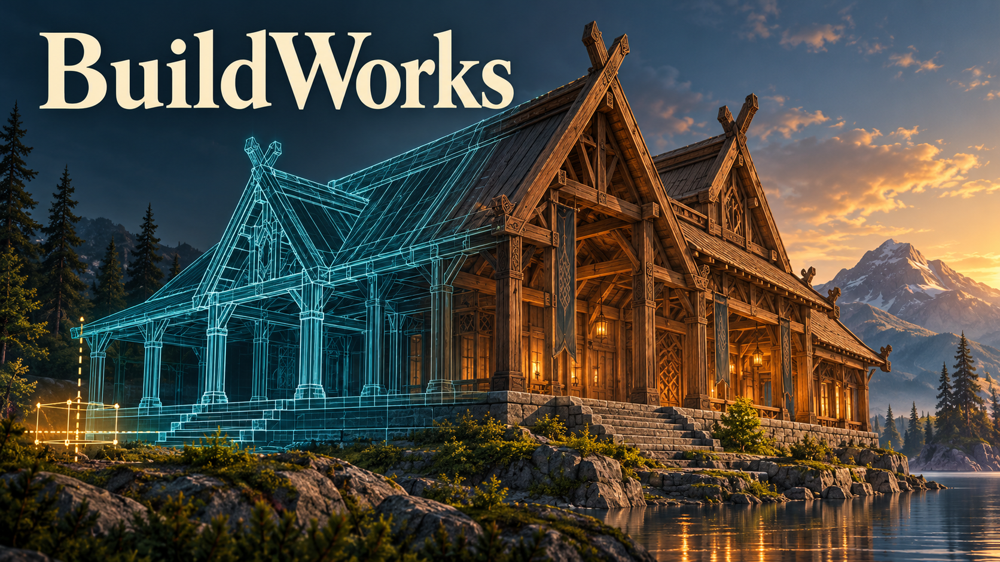
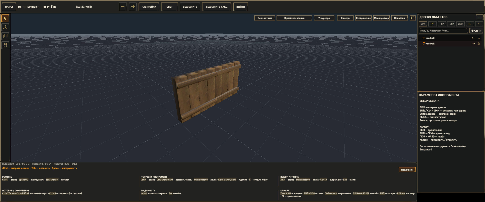
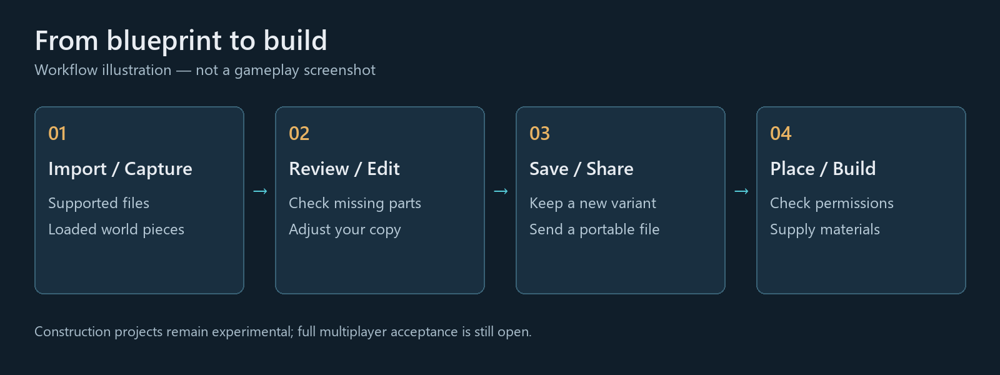

# BuildWorks

**[English](README.md) · Русский**

Точные строительные инструменты и повторно используемые чертежи для Valheim: сохраните постройку, измените отдельные детали и создавайте свои варианты.

*Оригинальная промо-иллюстрация. Это не снимок Valheim и не доказательство законченного строительного пути.*

## Возможности

- Положение и поворот по XYZ, привязки, числовые значения и положительный масштаб по компонентам.
- Редактор с деревом, группами, опорами, видимостью, отдельной камерой и Undo/Redo.
- Захват загруженных строительных деталей и поддерживаемый импорт `.blueprint`/`.vbuild`; отсутствующие детали сначала показываются в обзоре.
- Категории, «Сохранить как», отдельные варианты и передача сохранённых переносимых файлов.
- Повторения Array и Contour. Сохраняемые перенастраиваемые операции повторения — будущая работа.

BuildWorks активно развивается. У редактора и чертежей есть ограниченные принятые случаи; строительные проекты и полный сетевой путь ещё проверяются. Публичный пакет может содержать меньше функций, чем исходники. [Актуальные доказательства](docs/CURRENT_STATUS_RU.md).

## Посмотреть инструменты

*Реальный редактор .280, русский интерфейс. Контролируемая отрисовка работающей камеры и настоящего Canvas, не снимок рабочего стола. Кадр показывает интерфейс; оплату, reload и сеть он не доказывает.*

*Объясняющая схема, не игровой кадр. Стройка учитывает ресурсы, права, доступные детали и ограничения ниже.*

## Начать с небольшого чертежа

1. Импортируйте поддерживаемый файл либо выделите свои загруженные детали.
2. Проверьте состав, измените отдельную копию и сохраните вариант через «Сохранить как».
3. Перед строительством проверьте призрак размещения и стоимость.

[Русская вики](https://github.com/MaikiOS/BuildWorks/wiki/Home-RU) объясняет управление, missing, категории, обмен файлами и экспериментальные проекты. [English Wiki](https://github.com/MaikiOS/BuildWorks/wiki/Home) содержит те же темы.

## Установка и безопасное обновление

Используйте явно выпущенный пакет, совместимый с вашими Valheim и BepInExPack Valheim 5.4.x. Закройте игру/сервер и сохраните резервные копии мира, персонажа и данных BuildWorks.

Установите согласованную пару `BuildWorks.dll` и `BuildWorks.Geometry.dll` в `BepInEx/plugins/Ostrix-BuildWorks/`; устраните дубликаты. Проверьте версию в `BepInEx/LogOutput.log`. Не смешивайте сборки и не рассчитывайте, что старая DLL прочитает новые форматы. [Установка](docs/INSTALL_RU.md).

## Текущие ограничения

Строительные проекты, материалы, отмена и возврат экспериментальны и имеют ограниченные локальные подтверждения. Полное выживание, сохранность всех свойств предметов, восстановление после сбоев и host+remote ещё не приняты. Файловый обмен есть; прямая передача игроку в игре не подключена. Выделение работает с загруженными объектами, без принудительной загрузки дальних зон.

Большие/модовые здания, восстановление содержимого, взаимодействие с объёмом выделения и крайние случаи мыши/отрисовки ещё требуют проверок. OBJ/FBX/glTF и рельеф не входят в модуль чертежей. EarthWorks — отдельная будущая интеграция, не зависимость.

## Руководства и развитие

[Управление](docs/CONTROLS_RU.md) · [Документация](docs/README_RU.md) · [Дорожная карта](docs/ROADMAP_RU.md) · [Вклад](CONTRIBUTING_RU.md)

В дальнейшем — редактируемые сборки/повторения, направляющие и оригинальные адаптивные детали. Это не обещания первого релиза. [Стандарт ведения README](docs/README_STANDARD.md).

## Поддержка и лицензия

В сообщении об ошибке укажите версии, нужный лог, шаги и разрешённый пример. Не включайте личные saves или токены. [Сообщить об ошибке](https://github.com/MaikiOS/BuildWorks/issues).

BuildWorks имеет proprietary/source-available лицензию и не является open-source. Личное некоммерческое тестирование официальных сборок и доступ для вклада регулирует [лицензия](LICENSE); распространение и другое повторное использование требуют письменного разрешения владельца.
